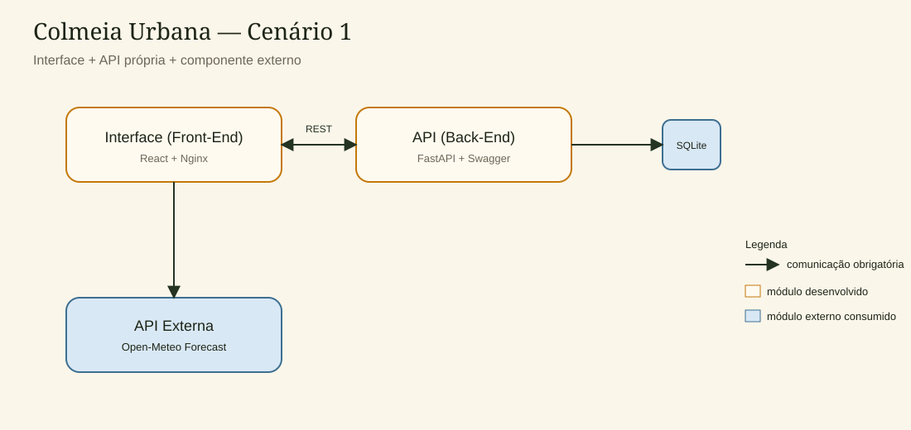

# Colmeia Urbana Web

Interface da **Colmeia Urbana**, um painel para monitoramento de apiários comunitários: colmeias, revisões de campo, colheitas e o clima do ponto de instalação.

Este repositório é a **componente principal** do MVP. Ele se comunica com a API REST própria e consome a API externa **Open-Meteo**, sem redirecionar o usuário para outro site.

## O problema

Quem cuida de colmeias em parques e hortas urbanas precisa cruzar o histórico do apiário com a janela de voo das abelhas. A aplicação reúne esses dados em um só lugar: o apicultor registra o que acontece na caixa e vê, na hora, se o tempo favorece revisão ou colheita.

## Arquitetura

Implementação do **Cenário 1**: Interface, API de persistência e serviço externo.



Fluxo de comunicação:

1. A interface chama a **Colmeia Urbana API** com `GET`, `POST`, `PUT` e `DELETE`.
2. A API grava colmeias, revisões e colheitas no **SQLite**.
3. A interface consulta o **Open-Meteo** com as coordenadas da colmeia, trata os dados (tradução do código do tempo e índice de voo das abelhas) e exibe o resultado no painel.

## API externa utilizada

- **Nome:** Open-Meteo Forecast API
- **Site:** https://open-meteo.com/
- **Documentação:** https://open-meteo.com/en/docs
- **Licença:** [CC BY 4.0](https://creativecommons.org/licenses/by/4.0/) — uso gratuito, inclusive comercial, com atribuição
- **Cadastro:** não é necessário
- **Chave de API:** não é necessária
- **Rota consumida:** `GET https://api.open-meteo.com/v1/forecast`
- **Parâmetros usados:** `latitude`, `longitude`, `current`, `daily`, `timezone`, `forecast_days`
- **Tratamento local:** a resposta é convertida para português, e um índice de voo é calculado com temperatura, chuva e vento. O usuário permanece na aplicação.

## Chamadas HTTP da interface

| Método | Quando acontece na tela |
| --- | --- |
| `GET` | Painel, listagem e ficha da colmeia |
| `POST` | Login, cadastro de colmeia, revisão e colheita |
| `PUT` | Edição da ficha da colmeia |
| `DELETE` | Exclusão de colmeia, revisão ou colheita |

Além do CRUD, a interface traz dashboard com gráficos, cartões de clima, índice de voo e filtros de busca.

## Instalação local

1. Instale o **Node.js 20** e tenha a API rodando em `http://localhost:8000`.
2. Instale as dependências:

```bash
npm install
```

3. Inicie o servidor de desenvolvimento:

```bash
npm run dev
```

4. Abra `http://localhost:5173`.

O Vite encaminha `/api` para a API local.

Conta de demonstração:

- **E-mail:** `apicultor@colmeia.dev`
- **Senha:** `colmeia123`

## Execução com Docker Compose

O `docker-compose.yml` está na raiz deste repositório (componente principal) e sobe a interface e a API.

Mantenha as pastas irmãs:

```text
projeto/
├── colmeia-api/
└── colmeia-web/    ← você está aqui
```

Na pasta `colmeia-web`:

```bash
docker compose up --build
```

- Interface: `http://localhost:3000`
- Swagger da API: `http://localhost:8000/docs` ou `http://localhost:3000/docs`

Para encerrar:

```bash
docker compose down
```

## Execução apenas da interface

```bash
docker build -t colmeia-web .
docker run --rm -p 3000:80 colmeia-web
```

Neste modo isolado, o proxy `/api` espera um serviço chamado `api`. Prefira o `docker compose` para o sistema completo.

## Estrutura

```text
colmeia-web/
├── Dockerfile
├── docker-compose.yml
├── nginx.conf
├── README.md
├── public/
│   └── architecture.svg
└── src/
    ├── api.js
    ├── weather.js
    ├── pages/
    └── components/
```
